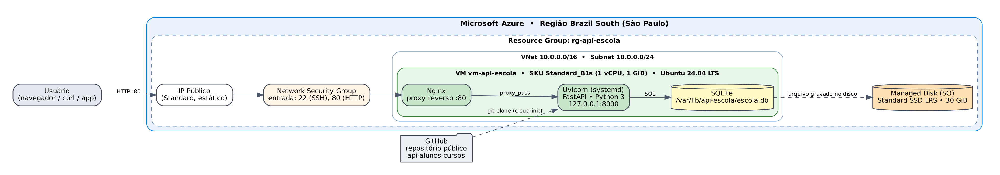
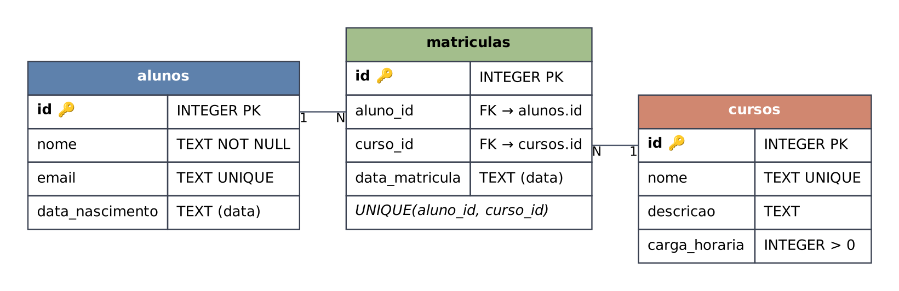

# API Escola — Alunos, Cursos e Matrículas

API REST em **Python + FastAPI** com banco de dados **SQLite**, hospedada em uma **máquina virtual Linux na Microsoft Azure** (SKU `Standard_B2pts_v2`, Arm64, Ubuntu 24.04 LTS, região Central US).

**API publicada:** http://52.230.164.119/docs

📄 Documentação completa: [Word](docs/Documentacao_API_Escola.docx) · [PDF](docs/Documentacao_API_Escola.pdf)



## Funcionalidades

| Recurso     | Rotas                                                                 |
|-------------|------------------------------------------------------------------------|
| Status      | `GET /`, `GET /health`                                                 |
| Cursos      | `GET/POST /cursos`, `GET/PUT/DELETE /cursos/{id}`                      |
| Alunos      | `GET/POST /alunos`, `GET/PUT/DELETE /alunos/{id}`, `GET /alunos/{id}/cursos` |
| Matrículas  | `GET/POST /matriculas`, `DELETE /matriculas/{id}`                      |

A documentação interativa (Swagger) fica em **`/docs`** e a alternativa (ReDoc) em **`/redoc`**.

Códigos de resposta: `200` ok · `201` criado · `204` removido · `404` não encontrado · `409` conflito (e-mail/curso/matrícula repetidos) · `422` dados inválidos.

## Modelo de dados



## Estrutura do projeto

```
api-alunos/
├── app/
│   ├── main.py            # rotas da API (FastAPI)
│   ├── database.py        # conexão e criação das tabelas SQLite
│   └── schemas.py         # validação dos dados (Pydantic)
├── tests/test_api.py      # 8 testes automatizados (pytest)
├── scripts/smoke_test.sh  # teste HTTP de ponta a ponta (local ou na nuvem)
├── deploy/
│   ├── azure_criar_vm.sh  # cria toda a infraestrutura na Azure (Azure CLI)
│   ├── cloud-init.yaml    # configura a VM no primeiro boot
│   ├── instalar_na_vm.sh  # instala/atualiza a API na VM (via Run Command)
│   └── atualizar_vm.sh    # atualiza a API via SSH
├── docs/
│   ├── diagramas/         # arquitetura, modelo ER, fluxos
│   ├── prints/            # 14 prints (testes locais, API na Azure, portal)
│   ├── Documentacao_API_Escola.docx
│   └── Documentacao_API_Escola.pdf
├── requirements.txt
└── requirements-dev.txt
```

## Rodando localmente

```bash
python3 -m venv .venv
source .venv/bin/activate          # Windows: .venv\Scripts\activate
pip install -r requirements-dev.txt
uvicorn app.main:app --reload
# abra http://127.0.0.1:8000/docs
```

Testes:

```bash
pytest -v                    # testes automatizados
./scripts/smoke_test.sh      # chamadas HTTP reais na API rodando
```

## Publicando na Azure

No portal da Azure, abra o **Cloud Shell** (Bash ou PowerShell) e rode:

```bash
git clone https://github.com/RenesFernandes7366/api-alunos.git
cd api-alunos
bash -c "LOCATION=centralus SIZE=Standard_B2pts_v2 ./deploy/azure_criar_vm.sh"
```

O script confere se o tamanho da VM está liberado na região, cria Resource Group, VM, rede, IP público e NSG e libera a porta 80. Tamanhos Arm (com `p` no nome) usam automaticamente a imagem Ubuntu Arm64.

Para instalar ou atualizar a API dentro da VM (também usado depois de um novo `git push`):

```bash
az vm run-command invoke -g rg-api-escola -n vm-api-escola --command-id RunShellScript \
  --scripts "@deploy/instalar_na_vm.sh" --query "value[0].message" -o tsv
```

Validar:

```bash
curl http://52.230.164.119/health
bash -c "./scripts/smoke_test.sh http://52.230.164.119"
```

Para remover tudo e parar a cobrança: `az group delete --name rg-api-escola --yes`.

## Recursos na Azure

| Recurso         | Valor                                                     |
|-----------------|-----------------------------------------------------------|
| Resource Group  | `rg-api-escola`                                           |
| Região          | Central US                                                |
| VM / SKU        | `vm-api-escola` – `Standard_B2pts_v2` (2 vCPU, 1 GiB, Arm64) |
| SO              | Ubuntu 24.04 LTS (`ubuntu-24_04-lts:server-arm64`)        |
| Disco           | Managed Disk Standard SSD LRS, 30 GiB                     |
| Rede            | `vm-api-escolaVNET` / `vm-api-escolaSubnet`, IP privado 10.0.0.4 |
| IP público      | 52.230.164.119                                            |
| NSG             | `vm-api-escolaNSG` – entrada 22 (SSH) e 80 (HTTP)         |

## Tecnologias

| Camada          | Tecnologia                                  |
|-----------------|---------------------------------------------|
| Linguagem       | Python 3.12                                 |
| Framework web   | FastAPI + Uvicorn (ASGI)                    |
| Validação       | Pydantic v2                                 |
| Banco de dados  | SQLite 3 (arquivo `escola.db`)              |
| Servidor web    | Nginx (proxy reverso)                       |
| Nuvem           | Azure VM `Standard_B2pts_v2`, Ubuntu 24.04 LTS Arm64 |
| Armazenamento   | Managed Disk Standard SSD LRS, 30 GiB       |
| Testes          | pytest + httpx                              |
